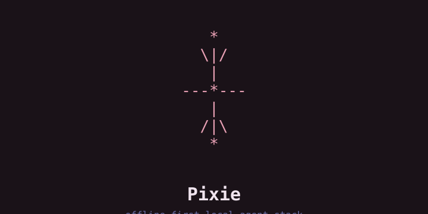
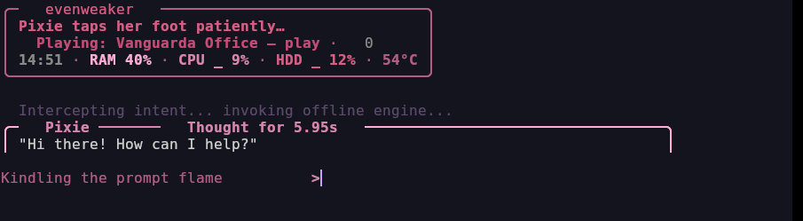
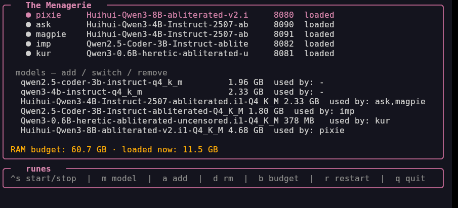

# Pixie — local AI agent ✨

Offline-first local familiar: **pixie** (Rust engine — files + house spells + runes), **imp** (terminal art), **menagerie** (llama-server control plane). No cloud, no telemetry.

```
git clone git@github.com:ElegantVW/pixie.git ~/pixie
cd ~/pixie && ./build.sh install --house
# models → ~/.local/share/pixie/models/*.gguf
```

Then: `menagerie status all` and `pixie "hello"`. Bare `pixie` is the TUI: Tab / Shift-Tab cycle Runes, house-star wait glyph, a prompt that grows as you type, file cards with `l` look / `o` open. Tools: `list_dir`, in-tree `grep_files`, `edit_local_file` in Build. Vision (`look`) is still sleeping — no extra model download.

## Look




## Apps + ports

| App | Port | Default model |
|-----|------|----------------|
| pixie | 8080 | qwen3-4b (8B on this house) |
| magpie (external) | 8091 | qwen3-4b |
| imp | 8082 | qwen-coder first |
| kur (external) | 8081 | smollm2-360m |

## Layout

| Path | Role |
|------|------|
| `src/` | Rust pixie (TUI, tools, host card) |
| `scripts/pixie` | thin launcher |
| `bin/menagerie*` | control plane (Python/bash) |
| `bin/imp` `bin/ask` | art / one-shot helper |
| `config/pixie/` | spells + context pack |
| `docs/pixie.md` | living plan |

## Voice

Cute after competence. Errors: `pixie: <one sentence>` + `next: <one thing>`.

## What never goes in git

`*.gguf`, `*.so*`, `llama-server` binaries, session jsonl, `memory.md`, `menagerie.json`, credentials, client PII.

## License

MIT — see [LICENSE](LICENSE).
